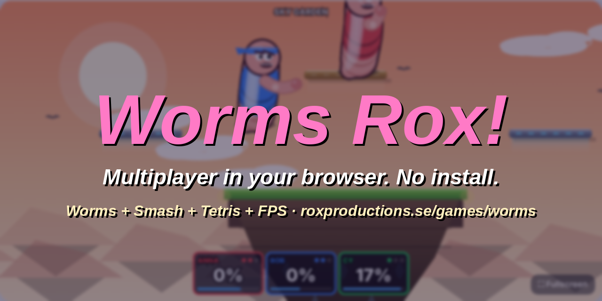
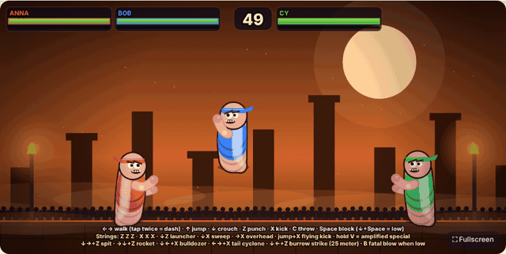
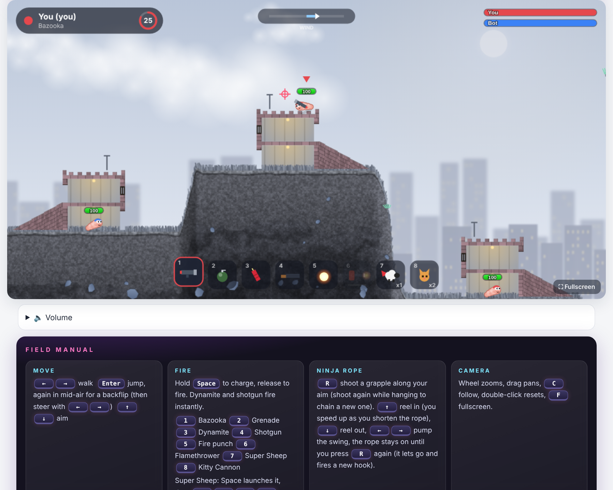
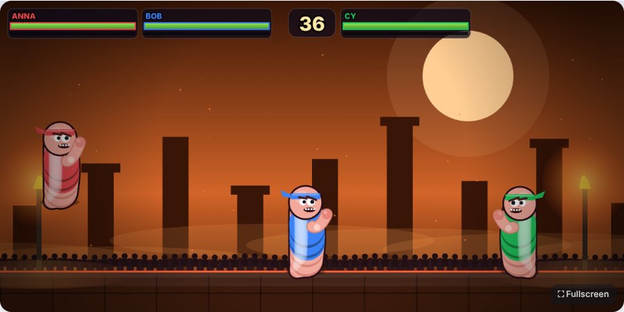
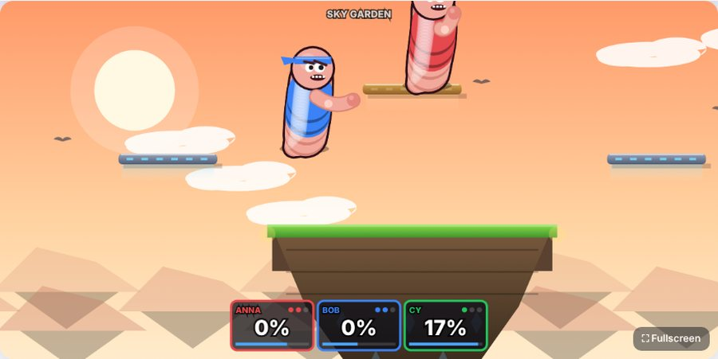
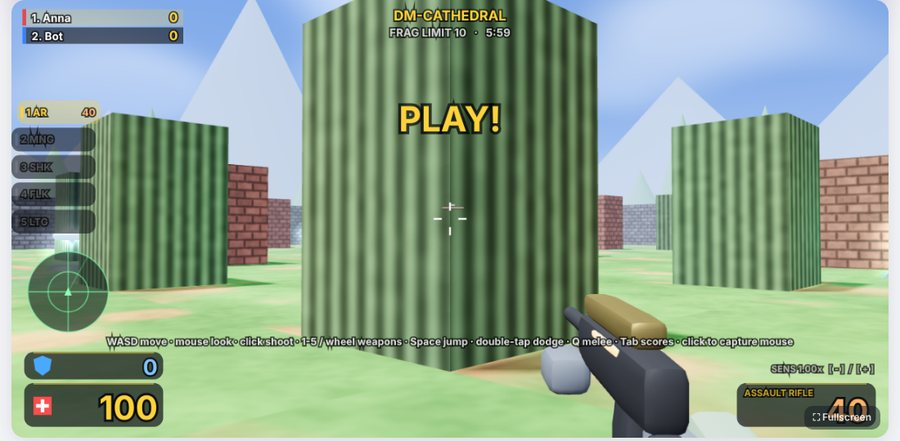
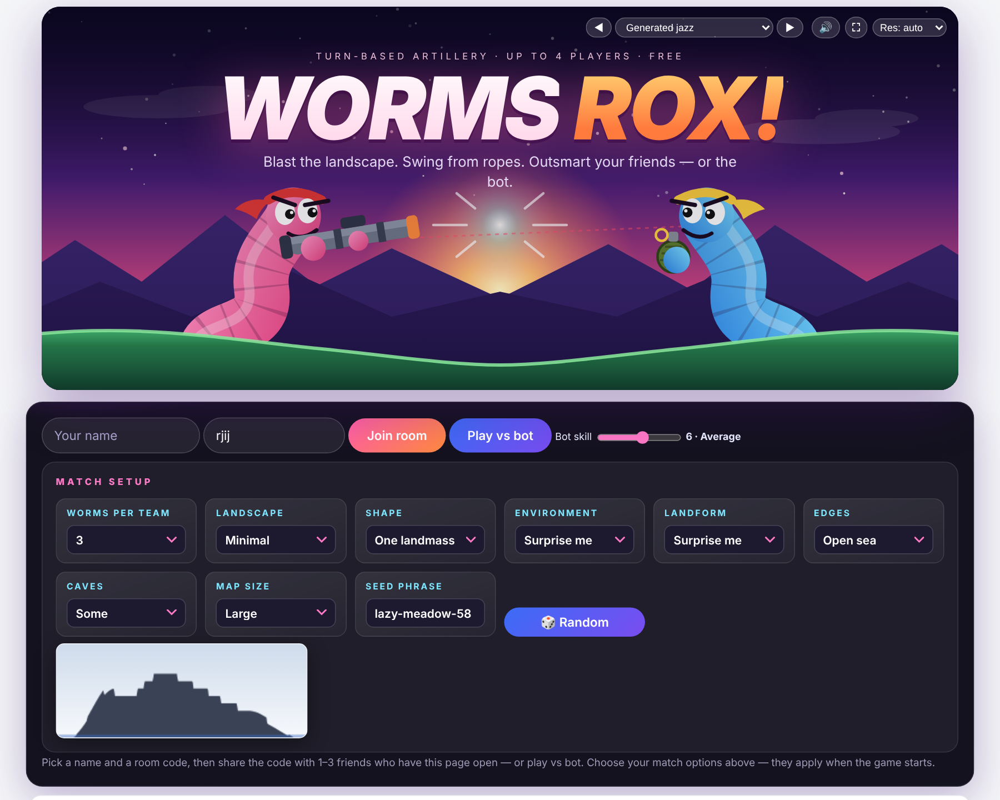

# Worms Rox!

<p align="center"></p>

<h2 align="center">▶ <a href="https://roxproductions.se/games/worms/">Play now → roxproductions.se/games/worms</a></h2>
<p align="center">Free · multiplayer in your browser · no install · up to 4 players or vs a bot<br>
<a href="https://roxproductions.se/games/worms/alerts.html">🔔 Get a phone alert when someone is playing</a> ·
<a href="../../releases">Download</a> ·
<a href="../../discussions">Discussions</a> ·
<a href="CONTRIBUTING.md">Contribute</a></p>



A turn-based artillery game for the browser, in the spirit of Worms: up to four players (or you vs a bot) blow up
procedurally generated landscapes with bazookas, grenades, dynamite, flamethrowers, Super Sheep and Kitty Cannons,
swing around on a ninja rope, and fight over crates that unlock mini-games where **every team plays at once**.

The whole game is **one HTML file** (`index.html`): no server, no install, no build step needed to play.

| Worms | Mortal Worm Combat | Smash Brawl | FPS arena |
| --- | --- | --- | --- |
|  |  |  |  |



## Play

- **Right now:** open `index.html` in a browser, or serve the folder (`npm run serve`, then http://localhost:8080).
- **On the web:** upload `index.html` to any static host. With GitHub Pages: *Settings → Pages → Deploy from branch → `main` / root*.
- **Vs the bot:** pick your match options, then press **Play vs bot** (skill slider 1–10).
- **With friends:** everyone enters a name and the same room code and presses **Join room**. The host picks the options and presses **Start game**.

### Controls

| Key | Action |
| --- | --- |
| `←` `→` | Walk (steer in mid-air) |
| `Enter` | Jump (again in mid-air: backflip) |
| `↑` `↓` | Aim |
| `Space` | Hold to charge, release to fire |
| `1`–`8` | Bazooka, Grenade, Dynamite, Shotgun, Fire punch, Flamethrower, Super Sheep, Kitty Cannon |
| `R` | Fire the ninja rope; press again to let go (`↑`/`↓` reel, `←`/`→` swing) |
| `C` / `F` | Camera follow / fullscreen (wheel zooms, drag pans) |
| `[` `]` or `,` `.` | Previous / next radio station |

## Features

- Procedural maps: landforms, caves, islands, bridges, castles, themes, three map sizes, open-sea edges, seed phrases (share a seed to replay a map).
- Rope physics, wind, water, crates (weapons, health, mini-games), sudden-death duel.
- Crate mini-games, all teams playing at once (the loser's worm dies): Tetris race, Rock-Paper-Scissors, Mortal Worm Combat, Smash Brawl, FPS arena (WebGL, Unreal Tournament style).
- Bot opponent with a 1–10 skill slider.
- **Voices:** pre-rendered Southern-American voice clips (tipsy man and woman) generated with Qwen3-TTS; falls back to browser speech synthesis if the voice pack is missing.
- **Radio:** switch between generated jazz and online radio streams (SomaFM, Radio Paradise) from the top bar.
- Sound effects are synthesised in the browser (Web Audio), nothing to download.

## Online multiplayer

The page picks a transport automatically:

1. **Same browser** (tabs/windows): BroadcastChannel, works offline.
2. **Peer-to-peer** (default for different computers): WebRTC via PeerJS; the free public PeerJS broker is only used for the handshake. The first player in a room becomes the hub; if the host leaves, someone else takes over. Strict NATs/firewalls may block it (no TURN server is included).
3. **WebSocket relay** (most reliable): a tiny relay that every player connects to over `wss://`. Two options are included:
   - `relay/cloudflare/`: free Cloudflare Worker + Durable Object. `cd relay/cloudflare && npx wrangler login && npx wrangler deploy`
   - `relay/node/`: `npm install && node relay-server.js` (port 8787; put it behind TLS).
   - Play alerts: the relay can push a phone notification (via ntfy) when someone starts playing; see `docs/ALERTS.md` and `src/alerts.html`.

Use a relay without rebuilding by opening `index.html?relay=wss://your-relay.example`, or bake it in at build time (below).

URL options: `?relay=wss://…`, `?p2p=0` (tabs only), `?peerhost=&peerport=&peerpath=&peersecure=` (your own PeerServer).

## Build from source

```bash
npm install
npm run build          # src/worms.html + PeerJS + three.js + transport + voices -> index.html
npm run serve          # http://localhost:8080
npm test               # headless smoke test (needs Playwright's Chromium, or CHROME=/path/to/chrome)
```

To bake your relay into the build, either `WORMS_RELAY=wss://your-worker.workers.dev npm run build` or copy
`config.example.json` to `config.local.json` (git-ignored) and edit it. `npm run build:novoices` skips the voice pack (≈1 MB instead of ≈3 MB).

### Layout

```
src/worms.html      the game (HTML + CSS + JS)
src/transport.js    multiplayer transport (tabs / PeerJS / WebSocket relay)
scripts/            build.mjs, serve.mjs, extract-lines.mjs
voices/             voice pack: lines.json, gen_voices.py, pack_voices.py, voices.js (generated)
relay/              Cloudflare Worker and Node relays
tests/smoke.mjs     headless smoke test
index.html          built single-file game (committed so GitHub Pages works)
```

### Changing the voices

`voices/gen_voices.py` renders every voice line with [Qwen3-TTS](https://github.com/QwenLM/Qwen3-TTS) VoiceDesign from a text description of each character
(edit `VOICES` at the top). It needs `pip install qwen-tts soundfile`, `ffmpeg` and `sox`, and runs on CPU (slow) or GPU.

```bash
npm run voices:lines   # only after adding/changing lines in src/worms.html
npm run voices:gen     # render clips into voices/clips/ (resumable)
npm run voices:pack    # pack into voices/voices.js
npm run build
```

## Credits and licences

- Game code: MIT (see `LICENSE`).
- [three.js](https://threejs.org) r128 (MIT) and [PeerJS](https://peerjs.com) 1.5.4 (MIT) are inlined into the built `index.html`.
- Voice clips were generated with Qwen3-TTS (Apache-2.0).
- Radio streams are played directly from [SomaFM](https://somafm.com) and [Radio Paradise](https://radioparadise.com); nothing is redistributed. Please support them.
- "Worms" is a trademark of its owners. This is an unaffiliated fan project and contains no assets from the original games.
